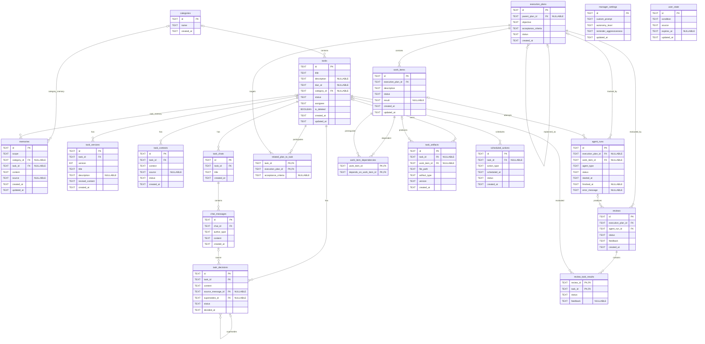

# SPEC.md

# Autonomous AI Work Manager

## 1. プロジェクト概要

### 1.1 目的

Autonomous AI Work Managerは、ユーザーのタスクをAIが自律的に把握し、調査・計画・作業・成果物作成・レビュー・進捗管理を実行する、個人用のAIタスクマネージャーである。

ユーザーが具体的な作業手順を毎回指示する必要を減らし、AI自身が次に実行すべき仕事を判断して進めることを目的とする。

ユーザーが疲れている場合や、何から着手すればよいか分からない場合にも、AIが状況に応じて作業を進め、適切なタイミングで声をかける。

### 1.2 基本コンセプト

**ユーザーが目標を管理し、AIがその目標を達成するための仕事を主体的に進める。**

主な機能：

1. タスク一覧をAIが継続的に把握する。
2. Manager AIが優先順位と実行対象を判断する。
3. 関連する複数タスクをまとめて実行できる。
4. Manager AIが具体的な作業指示を作成する。
5. Work Itemに作業を分割する。
6. Worker AIが調査や資料作成を実行する。
7. Review AIが指示と完了条件に対する達成度を評価する。
8. 不合格の場合はManager AIが再計画する。
9. 合格した成果物はユーザーの確認待ちとする。
10. AIが適切なタイミングで通知する。
11. 過去の会話、正式な決定事項、調査結果を長期記憶として活用する。

### 1.3 対応プラットフォーム

以下の環境で動作すること。

- macOS
- Windows 11
- Windows Subsystem for Linux（WSL2）

アプリケーションの主要ロジックはOSに依存しない構成とする。

OS固有の処理は抽象化し、プラットフォーム別の実装で対応する。

対象となるOS固有機能：

- アプリの自動起動
- バックグラウンド実行
- データ保存ディレクトリ
- 認証情報の取得
- デスクトップ通知
- ブラウザ起動
- ファイルを既定アプリで開く操作

### 1.4 利用形態

- シングルユーザー
- ローカルWebアプリケーション
- ローカルデータ保存
- 外部LLM APIを利用
- MCPによる外部サービス連携
- バックグラウンドでの自律実行

---

## 2. 開発方針

### 2.1 完成品として開発する

本仕様書は、継続的に実利用できる完成品の開発を目的とする。

完成品には以下を含める。

- タスク管理
- AIによる自律実行
- 複数タスクの一括実行計画
- Worker AIによる作業
- Review AIによる検証
- 複数チャット
- 長期記憶
- Markdown成果物
- プロアクティブ通知
- スケジューラー
- MCP連携
- 複数LLMプロバイダー
- 設定画面
- 実行履歴
- エラー処理
- データバックアップ
- 再起動時の復旧
- 自動テスト
- 各OS向けの起動・インストール手順

### 2.2 UIの基本方針

UIは可能な限りシンプルにする。

ユーザーが日常的に扱う主要情報は以下に限定する。

- タスク
- チャット
- 成果物
- AIの作業状況
- 確認待ち
- 通知

実行計画やAgent Runなどの内部情報は、必要に応じて詳細表示できる構成にする。

### 2.3 軽量なフロントエンド

推奨技術：

- Svelte 5
- TypeScript
- Vite
- CSS
- Fetch API
- Server-Sent Events

フロントエンドはビルド済みの静的ファイルとして配信する。

バックエンドのFastAPIから配信し、通常利用時のプロセス数とメモリ消費を抑える。

### 2.4 Markdown First

**AIが生成する成果物は原則Markdownとする。**

対象例：

- 技術調査レポート
- 設計書
- 仕様書
- 手順書
- 議事録
- 回答案
- 比較表
- 提案書
- 作業報告
- 調査メモ

成果物はローカルファイルとして保存する。

アプリから閲覧・編集・コピー・履歴確認できること。

必要に応じて他形式へエクスポートできる拡張性を確保する。

---

## 3. 技術スタック

### 3.1 フロントエンド

| 項目 | 技術 |
|---|---|
| フレームワーク | Svelte 5 |
| 言語 | TypeScript |
| ビルド | Vite |
| UI | CSS |
| API通信 | Fetch API |
| イベント受信 | SSE |
| Markdown | Markdownパーサー |
| 配信 | FastAPI Static Files |

### 3.2 バックエンド

| 項目 | 技術 |
|---|---|
| 言語 | Python 3.12以降 |
| Web API | FastAPI |
| バリデーション | Pydantic |
| ORM | SQLAlchemy |
| Migration | Alembic |
| AI Framework | LangChain |
| AI Workflow | LangGraph |
| DB | SQLite |
| 全文検索 | SQLite FTS5 |
| 外部連携 | MCP |
| バックグラウンド処理 | Python Orchestrator |
| 設定 | .env + アプリ設定 |
| 認証情報管理 | OS別Secret Provider |

### 3.3 LLM

標準プロバイダーはOpenAIとする。

プロバイダーの切り替えに対応する。

対象：

- OpenAI
- Anthropic
- Google Gemini
- アダプターで追加したプロバイダー

Manager AI、Worker AI、Review AIごとにモデルを設定できること。

設定項目：

- プロバイダー
- モデル
- 認証情報
- カスタムプロンプト
- Temperatureなどのモデルパラメータ
- タイムアウト
- 再試行設定

### 3.4 開発・実行環境

Python依存関係は`pyproject.toml`で管理する。

フロントエンドの開発・ビルドにはNode.jsを使用する。

各OSで同じアプリケーションコードを利用できる構成とする。

---

## 4. 設定管理とAPIキー

### 4.1 基本方針

アプリケーション設定の起点は`.env`ファイルとする。

設定は以下の2種類に分ける。

1. 一般設定
2. 認証情報

一般設定は`.env`やアプリ内設定DBで管理する。

認証情報はOSに応じたSecret Providerから取得する。

### 4.2 .envの設定例

```dotenv
APP_HOST=127.0.0.1
APP_PORT=8765

AIWM_DATA_DIR=

DEFAULT_LLM_PROVIDER=openai

MANAGER_MODEL=gpt-6
WORKER_MODEL=gpt-6
REVIEW_MODEL=gpt-6

SECRET_BACKEND=auto

OPENAI_API_KEY=
ANTHROPIC_API_KEY=
GOOGLE_API_KEY=

AUTO_START_MANAGER=true
ENABLE_DESKTOP_NOTIFICATIONS=true
```

`SECRET_BACKEND`は以下を指定できること。

- `auto`
- `keychain`
- `dotenv`

`auto`ではOSに応じたSecret Providerを選択する。

### 4.3 macOSでのAPIキー管理

macOSではKeychainを優先する。

起動時の動作：

1. `.env`から一般設定を読み込む。
2. 必要なLLMプロバイダーを確認する。
3. Keychainから対応するAPIキーを検索する。
4. 登録済みのキーがあれば取得する。
5. 未登録の場合はユーザーにAPIキーの入力を求める。
6. 入力されたキーをKeychainに保存する。
7. APIキーをアプリ内部のSecret Providerへ注入する。
8. LLMクライアントを初期化する。
9. バックエンドを起動する。

Macの通常運用では、`.env`のAPIキーフィールドは空欄のまま利用できること。

### 4.4 macOSの初回起動

初回起動時にAPIキーが存在しない場合、CLIまたはセットアップUIから入力できること。

CLIの例：

```text
AI Work Manager Setup

OpenAI API Key is not configured.

Please enter your API key:
***************

Save this key to macOS Keychain? [Y/n]
```

保存後は次回起動時にKeychainから取得する。

新しいプロバイダーを設定した場合も、そのプロバイダーのAPIキー登録を求める。

### 4.5 アプリ起動時のキー注入

APIキーはSecret Providerから取得し、LLMクライアントへメモリ上で渡す。

概念的な実装：

```python
class SecretProvider:
    def get_secret(self, name: str) -> str | None:
        ...

class LLMFactory:
    def __init__(self, secret_provider: SecretProvider):
        self.secret_provider = secret_provider

    def create_openai_client(self):
        api_key = self.secret_provider.get_secret(
            "OPENAI_API_KEY"
        )

        return ChatOpenAI(
            api_key=api_key,
            model="gpt-6",
        )
```

起動処理では、認証情報を取得・登録するBootstrap処理を実装する。

Bootstrap完了後に、認証情報を注入したサービスを使ってバックエンドを起動する。

Keychain操作はOS Adapterとして分離する。

### 4.6 WindowsでのAPIキー管理

Windowsでは`.env`からAPIキーを取得する方式を標準とする。

例：

```dotenv
SECRET_BACKEND=dotenv

OPENAI_API_KEY=your-api-key
ANTHROPIC_API_KEY=
GOOGLE_API_KEY=
```

取得した認証情報は、アプリ内部のSecret Providerを通じてLLMクライアントに渡す。

将来的にWindows Credential Managerへ対応できる拡張性を持たせる。

### 4.7 WSLでのAPIキー管理

WSLではLinux側の`.env`を利用する方式を標準とする。

例：

```text
/home/user/projects/ai-work-manager/.env
```

WindowsとWSLの認証情報管理は独立した設定として扱う。

### 4.8 Secret Providerの構成

以下のインターフェースを定義する。

```python
class SecretProvider(Protocol):
    def get_secret(self, name: str) -> str | None:
        ...

    def set_secret(self, name: str, value: str) -> None:
        ...

    def delete_secret(self, name: str) -> None:
        ...
```

実装：

```text
SecretProvider
├── MacOSKeychainSecretProvider
└── DotEnvSecretProvider
```

`auto`の動作：

- macOS：Keychain
- Windows：DotEnv
- WSL：DotEnv

### 4.9 セキュリティ要件

**禁止事項：**

- APIキーをアプリケーションログへ出力すること。
- APIキーをSQLiteへ平文保存すること。
- macOSのKeychainから取得したAPIキーを環境変数へ書き戻すこと。
- APIキーをフロントエンドへ返すこと。
- APIキーをGit管理対象へ含めること。
- APIキーをコマンドライン引数として渡すこと。

`.env`はGit管理対象から除外し、適切なファイルアクセス権限を設定する。

---

## 5. クロスプラットフォーム構成

### 5.1 OS Adapter

OS固有機能は共通インターフェースで抽象化する。

```text
PlatformAdapter
├── MacOSPlatformAdapter
├── WindowsPlatformAdapter
└── LinuxPlatformAdapter
```

対象機能：

```text
get_data_directory()
get_config_directory()
open_browser()
open_file()
show_notification()
install_autostart()
remove_autostart()
get_platform_info()
```

WSLではLinux Adapterを基本とし、Windowsホストとの連携が必要な操作にはWSL用Adapterを追加する。

### 5.2 データ保存先

標準保存先：

macOS：

```text
~/.ai-work-manager/
```

Windows：

```text
%LOCALAPPDATA%\AIWorkManager\
```

WSL：

```text
~/.ai-work-manager/
```

`AIWM_DATA_DIR`により保存先を変更できること。

### 5.3 ディレクトリ構成

```text
AIWorkManager/
├── data/
│   └── app.db
│
├── artifacts/
│   ├── task-001/
│   └── task-002/
│
├── backups/
├── logs/
├── exports/
└── config/
    └── settings.json
```

### 5.4 自動起動

プラットフォームごとに以下を実装する。

macOS：

- launchd

Windows：

- Windows Task Scheduler

WSL：

- systemd user serviceまたは利用環境に応じた起動方式

WSLではsystemdの利用可否を検出し、対応する起動方式を選択する。

自動起動の登録・解除は設定画面から操作できること。

### 5.5 通知

macOS：

- macOS通知

Windows：

- Windows Toast通知

WSL：

- Windowsホスト側への通知ブリッジ
- アプリ内通知

通知機能はPlatform Adapterを介して利用する。

### 5.6 ブラウザアクセス

フロントエンドはFastAPIから配信する。

標準URL：

```text
http://127.0.0.1:8765
```

macOS、Windows、WSLからローカルブラウザで利用できること。

WSLではWindowsホスト側のブラウザからアクセスする利用形態をサポートする。

WSLのネットワーク構成によって追加設定が必要な場合、セットアップ手順に含める。

### 5.7 アプリの起動

以下の起動方法を提供する。

```text
macOS:
./scripts/start.sh

Windows:
scripts\start.ps1

WSL:
./scripts/start.sh
```

同様に停止・インストール・アンインストール用のスクリプトを用意する。

---

## 6. システムアーキテクチャ

### 6.1 全体構成

```text
Web Browser
    │
    ▼
Svelte Frontend
    │
    ▼
FastAPI Backend
    │
    ├── Task Service
    ├── Chat Service
    ├── Memory Service
    ├── Artifact Service
    ├── Notification Service
    ├── Settings Service
    ├── MCP Integration Service
    │
    ├── AI Orchestrator
    │     ├── Scheduler
    │     ├── Manager AI
    │     ├── Worker AI
    │     └── Review AI
    │
    ├── SQLite
    ├── Markdown Artifacts
    ├── Secret Provider
    └── Platform Adapter
```

### 6.2 プロセス

基本的には1つのPythonバックエンドプロセスで動作させる。

FastAPIとAI Orchestratorを同一アプリケーション内で管理する。

AI処理はバックグラウンドで非同期実行する。

ブラウザを閉じた後もバックエンドは動作を継続できる構成にする。

### 6.3 単一インスタンス

バックエンドの多重起動を検出する。

同一データベースに対して複数のOrchestratorが同時に処理することを防ぐ。

### 6.4 ローカルAPI保護

APIは原則としてlocalhostにバインドする。

Origin検証、CSRF対策、適切なセッション保護を実装する。

---

## 7. AIエージェント

### 7.1 Manager AI

責務：

- 全タスクの把握
- 優先順位判断
- 実行対象タスクの選択
- 複数タスクの一括選択
- Execution Plan作成
- Work Item分割
- Workerへの指示
- Review結果の分析
- 再計画
- タスク追加・更新
- 通知判断
- 次回実行時刻の判断

Manager AIは、関連する複数のタスクを1つのExecution Planで処理できる。

### 7.2 Worker AI

責務：

- Work Itemの実行
- 情報調査
- ローカルファイル参照
- MCP経由の情報取得
- 調査結果の整理
- Markdown作成
- Markdown改訂
- 実行結果の報告

Workerは必要なWork Itemの数に応じて実行する。

初期実装では順次実行する。

### 7.3 Review AI

責務：

- Managerが定義した目的の確認
- 完了条件の検証
- Work Item結果の検証
- Markdown成果物の検証
- 情報源の確認
- タスク単位の合否判定

判定：

```text
passed
failed
blocked
```

### 7.4 Review不合格時

Review AIが不合格を返した場合、Manager AIがレビュー結果を受け取って再計画する。

```text
Manager
   ↓
Execution Plan
   ↓
Worker
   ↓
Review
   ├── Passed → User Review Pending
   └── Failed → Manager → Replanning
```

Review AIの役割は評価とフィードバックに限定する。

### 7.5 再試行制御

設定可能な制限を設ける。

```yaml
max_replanning_attempts: 3
max_worker_retries: 2
max_consecutive_no_progress: 2
```

上限到達時には、状況をSQLiteへ保存し、必要に応じてユーザーへ通知する。

---

## 8. AI Orchestrator

### 8.1 基本方針

Python製OrchestratorがAI実行を管理する。

LangGraphの各実行は独立したRunとする。

必要なコンテキストは、実行開始時にSQLiteやファイルから構築する。

### 8.2 実行フロー

```text
Application Startup
       ↓
Load Tasks and State
       ↓
Manager AI
       ↓
Select Tasks
       ↓
Create Execution Plan
       ↓
Create Work Items
       ↓
Worker Execution
       ↓
Save Results
       ↓
Review AI
       ↓
Evaluate Results
       │
       ├── Passed
       │      ↓
       │   User Review Pending
       │
       └── Failed
              ↓
           Manager AI
              ↓
           Replanning
       ↓
Persist State
       ↓
Fresh Manager Execution
       ↓
Reevaluate All Tasks
```

### 8.3 実行の永続化

各Agent Runについて以下を保存する。

- Agent種別
- Execution Plan
- Work Item
- ステータス
- 開始日時
- 終了日時
- エラー情報
- 実行結果

Manager AI、Worker AI、Review AIの実行履歴を共通の仕組みで管理する。

### 8.4 再起動時の復旧

起動時に以下を確認する。

- 実行中だった計画
- 中断されたWork Item
- 完了済みのWork Item
- Review結果
- 予約済みアクション
- ユーザー確認待ち

保存済みの作業結果を再利用し、必要な処理を復旧する。

### 8.5 コンテキスト管理

Manager：

- タスク一覧
- 進捗
- 期限
- 関連Memory
- ユーザー状態

Worker：

- 作業指示
- 計画目的
- 完了条件
- 関連Memory
- 依存作業結果
- 参照資料

Review：

- 計画
- 完了条件
- 作業結果
- 成果物
- 出典

---

## 9. タスク管理

### 9.1 タスク情報

```text
id
title
description
due_at
category_id
status
assignee
is_deleted
created_at
updated_at
```

### 9.2 ステータス

```text
todo
in_progress
review_pending
blocked
completed
```

`completed`への移行は、原則としてユーザーの承認によって行う。

### 9.3 担当

```text
user
ai
shared
```

### 9.4 カテゴリー

カテゴリーは1階層とする。

1つのタスクは最大1つのカテゴリーに所属する。

カテゴリーの設定は任意とする。

### 9.5 バージョン管理

タスクの変更履歴を保存する。

変更前後の情報、変更日時、変更主体を追跡できること。

AIが変更した内容をユーザーが確認・取り消せるようにする。

---

## 10. Execution Plan

### 10.1 基本構成

Execution PlanはManager AIが作成する作業計画である。

1つのExecution Planは複数タスクを対象にできる。

1つのタスクには複数Execution Planを関連付けられる。

中間テーブル：

```text
related_plan_to_task
```

### 10.2 保存内容

```text
id
parent_plan_id
objective
acceptance_criteria
status
created_at
```

タスク単位の完了条件は`related_plan_to_task`にも保存する。

### 10.3 再計画

新しいExecution Planを生成し、`parent_plan_id`で再計画元を追跡する。

過去の計画は履歴として保持する。

---

## 11. Work Item

### 11.1 基本構成

```text
id
execution_plan_id
description
status
result
created_at
updated_at
```

### 11.2 ステータス

```text
pending
running
succeeded
failed
blocked
skipped
```

### 11.3 依存関係

`work_item_dependencies`で依存関係を管理する。

例：

```text
Work A ─┐
        ├── Work C ── Work D
Work B ─┘
```

依存関係は同一Execution Plan内で管理する。

循環依存を検証する。

### 11.4 Worker結果

Workerの実行結果は構造化して保存する。

例：

```json
{
  "work_item_id": "work-001",
  "status": "succeeded",
  "summary": "OIDC仕様の調査を完了",
  "artifact_ids": ["artifact-001"],
  "sources": [],
  "blockers": []
}
```

---

## 12. Review

Review AIはExecution Plan単位でレビューを実行する。

複数タスクを対象とする場合は、`review_task_results`にタスクごとの判定を保存する。

例：

| Task | Review |
|---|---|
| Task A | passed |
| Task B | failed |
| Task C | passed |

合格したタスクはユーザー確認待ちに移行できる。

不合格タスクはManager AIが再計画する。

### 12.1 ユーザーの操作

- 承認
- 修正依頼
- 追加調査依頼
- 保留

---

## 13. チャット

### 13.1 タスクごとの複数チャット

1つのタスクに複数のチャットを作成できる。

```text
Task
 ├── Chat A
 ├── Chat B
 └── Chat C
```

### 13.2 履歴の扱い

既存チャット：

- 同じチャットの過去メッセージ
- タスク情報
- 正式な決定事項
- 関連Memory

新規チャット：

- タスク情報
- 正式な決定事項
- 関連Memory

### 13.3 タスク一覧チャット

タスク一覧画面にManager AIへの指示欄を設ける。

ワンショットの指示として処理する。

指示により発生した変更や決定事項は永続化する。

---

## 14. 長期記憶

### 14.1 スコープ

```text
global
category
task
```

Global Memory：

全タスク共通の情報。

Category Memory：

カテゴリー内で共有する情報。

Task Memory：

個別タスクの情報。

### 14.2 データ構造

```text
id
scope
category_id
task_id
content
source
created_at
updated_at
```

### 14.3 検索

SQLite FTS5による検索を基本とする。

将来的なEmbedding検索に対応できる構成とする。

### 14.4 記憶の分類

- 仮説
- AIの推定
- 調査から得た情報
- 正式な決定事項

情報源と確定状態を適切に保持する。

---

## 15. 正式な決定事項

`task_decisions`に正式な決定事項を保存する。

保存内容：

```text
id
task_id
content
source_message_id
supersedes_id
status
decided_at
```

決定が変更された場合は、新しい決定を記録する。

過去の決定は履歴として保持する。

---

## 16. Markdown成果物

### 16.1 原則

AIの成果物は原則Markdownとする。

SQLiteにはメタデータを保存し、ファイル本体をローカルディレクトリへ保存する。

### 16.2 保存例

```text
artifacts/
├── task-001/
│   ├── research-v1.md
│   ├── research-v2.md
│   └── design.md
└── task-002/
    └── response-draft.md
```

### 16.3 機能

- Markdown生成
- プレビュー
- ソース表示
- 編集
- コピー
- ファイルを開く
- バージョン管理
- 差分表示
- 過去版への復元
- 承認
- 修正依頼

### 16.4 出典

外部情報を利用した成果物には出典を保存する。

調査結果の根拠を追跡できること。

### 16.5 複数タスクとの関連

共通Execution Planから生成された成果物は、関連する複数タスクから参照できること。

---

## 17. MCP連携

### 17.1 基本方針

MCP経由で外部サービスを利用する。

接続先ごとに必要な設定、認証、通信方式、ツール仕様が異なることを前提とする。

**各MCPサーバーへの接続に必要な処理を、アプリケーション側に実装する。**

汎用MCPクライアントを基盤とし、接続先固有の処理をAdapterとして追加できる構成にする。

### 17.2 対応する接続方式

以下をサポートする。

- stdio
- Streamable HTTP

必要に応じて接続先固有の互換処理を追加する。

### 17.3 接続先設定

MCPサーバーごとに以下を設定できること。

- サーバー名
- Transport
- 実行コマンド
- コマンド引数
- URL
- HTTP Header
- 認証方式
- 認証情報の参照先
- 接続タイムアウト
- 利用可能ツール
- 有効・無効
- ツール権限

### 17.4 stdio接続

設定例：

```json
{
  "name": "example-stdio",
  "transport": "stdio",
  "command": "node",
  "args": [
    "/path/to/mcp-server/index.js"
  ]
}
```

アプリは指定されたコマンドからMCPサーバーを起動し、標準入出力で接続する。

OSごとのパスやコマンド解決に対応する。

### 17.5 HTTP接続

設定例：

```json
{
  "name": "example-http",
  "transport": "streamable_http",
  "url": "https://example.com/mcp"
}
```

必要に応じて認証Headerやトークン取得処理を適用する。

### 17.6 認証

MCPサーバーの仕様に応じて以下をサポートする。

- API Token
- Bearer Token
- OAuth 2.0
- 認証不要の接続
- 接続先固有の認証方式

認証方式はMCP接続設定に関連付ける。

OAuthを使用する場合は以下を実装する。

- 認可URLへの遷移
- Callback処理
- Token取得
- Token更新
- 認証エラー処理
- 再認証

MCPの認証情報もSecret Provider経由で管理する。

### 17.7 MCPサーバーごとのAdapter

共通インターフェース：

```python
class MCPConnector(Protocol):
    async def connect(self):
        ...

    async def list_tools(self):
        ...

    async def call_tool(self, name: str, arguments: dict):
        ...

    async def disconnect(self):
        ...
```

接続先固有の実装では、必要に応じて以下を提供する。

- 固有の認証処理
- 固有の接続設定
- ツール名のマッピング
- 引数の変換
- レスポンスの正規化
- ページング処理
- レート制限対応
- エラー変換

### 17.8 対応する情報ソース

標準の連携対象：

- Slack
- Google Drive
- Confluence
- Jira
- ローカルファイル

各サービスについて、設定可能な接続実装を用意する。

外部サービスのAPI仕様が異なる場合は、サービスごとに必要な接続ロジックを追加する。

### 17.9 Jira

Jiraは調査情報源として利用する。

アプリ内タスクは独立したデータとして管理する。

### 17.10 Slack

Slackの会話や過去の問い合わせを調査できること。

回答案はMarkdown成果物として生成できること。

### 17.11 Google Drive・Confluence

文書の検索・取得に対応する。

取得した情報を調査やMarkdown成果物作成に利用できること。

### 17.12 ローカルファイル

ユーザーが設定したディレクトリを検索対象とする。

対象となるファイル形式は設定可能にする。

例：

```text
.md
.txt
.json
.yaml
.yml
.csv
.py
.ts
.js
.go
```

### 17.13 MCP接続管理UI

設定画面から以下を操作できること。

- 接続先追加
- 接続先編集
- 接続先削除
- 認証設定
- 接続テスト
- 利用可能ツール表示
- ツールの有効・無効
- エラー確認

### 17.14 MCPツールの権限

ツールごとに操作権限を設定する。

基本分類：

```text
read
internal_write
external_write
```

`external_write`は実行前にユーザー承認を必要とする。

**禁止事項：**

- 承認なしでSlackへ投稿すること。
- 承認なしで外部文書を更新すること。
- 承認なしでメールを送信すること。
- 外部文書に含まれる指示によって、ツールの権限を変更すること。

---

## 18. プロアクティブ通知

### 18.1 概要

Manager AIが通知内容と通知タイミングを判断する。

考慮する情報：

- タスク期限
- 進捗
- 確認待ち件数
- 過去の通知
- ユーザー状態
- 通知設定
- 作業の優先順位

### 18.2 通知設定

```text
low
normal
high
```

### 18.3 通知方法

- アプリ内通知
- AI Managerメッセージ
- OSデスクトップ通知

### 18.4 通知制御

- 重複通知の抑制
- 短時間の連続通知の抑制
- 通知停止時間帯
- 既読状態
- 通知履歴

---

## 19. ユーザー状態

### 19.1 概要

AIがユーザーの現在の調子を考慮する。

例：

```text
疲れている
集中できる
忙しい
時間がある
作業意欲が低い
```

### 19.2 情報源

- ユーザー入力
- チャットからの推定

推定情報には出典と有効期限を付ける。

### 19.3 保存内容

```text
condition
source
expires_at
updated_at
```

---

## 20. スケジューラー

### 20.1 役割

以下の実行タイミングを管理する。

- Manager AIの再評価
- 期限確認
- 通知
- ユーザー確認待ちの再通知
- エラー後の再試行

### 20.2 起動条件

- アプリ起動
- タスク作成
- タスク更新
- ユーザー指示
- Work Item完了
- Review完了
- スケジュール時刻
- ユーザー承認

### 20.3 待機

実行可能な処理がない場合は、次のイベントまたは予定時刻まで待機する。

### 20.4 永続化

スケジュールをSQLiteへ保存する。

アプリ起動時にスケジュールを復元する。

---

## 21. Manager AI設定

設定項目：

- カスタムプロンプト
- 自律性
- 通知積極性
- LLMモデル
- ユーザー状態
- MCP接続
- ローカル情報源
- 自動起動
- バックアップ

### 21.1 自律性

```text
conservative
balanced
proactive
```

### 21.2 カスタムプロンプト例

```text
技術調査は公式ドキュメントを優先してください。

疲れているときは負担の軽い作業を提案してください。

関連タスクは可能な範囲でまとめて調査してください。
```

---

## 22. フロントエンド

### 22.1 画面構成

```text
Task List
    │
    ├── Task Detail
    │     ├── Task Information
    │     ├── Chats
    │     ├── Artifacts
    │     └── History / Decisions
    │
    ├── AI Manager
    │
    └── Settings
```

### 22.2 メイン画面

表示項目：

- タスク一覧
- 期限
- ステータス
- カテゴリー
- AI作業状況
- 確認待ち
- AI Managerへの指示欄

### 22.3 タスク詳細

- 基本情報
- チャット
- 成果物
- 決定事項
- 変更履歴
- 実行履歴

高度な情報は詳細表示にまとめる。

### 22.4 成果物画面

- Markdownプレビュー
- ソース編集
- コピー
- ファイルを開く
- バージョン表示
- 差分表示
- 承認
- 修正依頼

### 22.5 AI作業状況

例：

```text
調査中
資料作成中
レビュー中
確認待ち
追加情報待ち
```

### 22.6 性能

- 初回表示の軽量化
- チャット履歴のページング
- Markdownの遅延読み込み
- SSEによる状態更新
- 大量タスクへの対応
- 軽量なコンポーネント構成

---

## 23. データモデル

### 23.1 基本方針

SQLiteを使用する。

構造化データはSQLiteに保存する。

Markdown成果物はローカルファイルとして保存する。

### 23.2 ER図



### 23.3 補助テーブル

以下を必要に応じて追加する。

- audit_events
- notifications
- app_events
- artifact_versions
- artifact_task_links
- mcp_connections
- mcp_tool_permissions

### 23.4 SQLite制約

- 外部キー
- NOT NULL
- UNIQUE
- CHECK
- 複合主キー
- 適切なインデックス
- トランザクション

主な制約：

```text
UNIQUE(task_id, version)
```

`work_item_dependencies`には循環依存検証を実装する。

`memories`ではスコープと参照先IDの整合性を検証する。

`review_task_results`では、対象タスクが該当Execution Planに含まれることを保証する。

### 23.5 SQLite設定

```sql
PRAGMA foreign_keys = ON;
PRAGMA journal_mode = WAL;
```

日時は原則UTCで保存し、UIではローカルタイムゾーンに変換する。

---

## 24. ローカルデータの永続化

### 24.1 方針

SQLiteをローカルファイルとして保存する。

実行環境としてDockerを必須としない構成とする。

### 24.2 保存内容

- タスク
- チャット
- 長期記憶
- 正式な決定事項
- 実行計画
- Work Item
- Agent Run
- Review
- スケジュール
- 通知
- 成果物メタデータ

Markdownはローカルファイルとして保存する。

### 24.3 WSL

WSLではLinuxファイルシステム内を標準保存先とする。

SQLiteの稼働中データベースには、Linux側のローカルファイルシステムを使用する。

### 24.4 バックアップ

SQLiteのバックアップAPIを利用する。

バックアップ対象：

- SQLite
- Markdown成果物
- アプリ設定

バックアップ先は設定可能にする。

### 24.5 復元

ユーザーがバックアップからデータを復元できること。

復元前に現在のデータを保護する。

---

## 25. API

FastAPIにREST APIを実装する。

### Tasks

```text
GET    /api/tasks
POST   /api/tasks
GET    /api/tasks/{id}
PATCH  /api/tasks/{id}
DELETE /api/tasks/{id}
POST   /api/tasks/{id}/approve
POST   /api/tasks/{id}/reopen
GET    /api/tasks/{id}/history
```

### Categories

```text
GET    /api/categories
POST   /api/categories
PATCH  /api/categories/{id}
DELETE /api/categories/{id}
```

### Chats

```text
GET    /api/tasks/{id}/chats
POST   /api/tasks/{id}/chats
GET    /api/chats/{id}/messages
POST   /api/chats/{id}/messages
```

### Manager

```text
POST   /api/manager/instruct
POST   /api/manager/run
GET    /api/manager/status
POST   /api/manager/pause
POST   /api/manager/resume
```

### Execution Plans

```text
GET    /api/execution-plans
GET    /api/execution-plans/{id}
GET    /api/execution-plans/{id}/work-items
GET    /api/execution-plans/{id}/reviews
```

### Artifacts

```text
GET    /api/artifacts/{id}
GET    /api/artifacts/{id}/content
PUT    /api/artifacts/{id}/content
GET    /api/artifacts/{id}/versions
POST   /api/artifacts/{id}/restore
```

### Memories

```text
GET    /api/memories
POST   /api/memories
PATCH  /api/memories/{id}
DELETE /api/memories/{id}
```

### Integrations

```text
GET    /api/integrations
POST   /api/integrations
PATCH  /api/integrations/{id}
POST   /api/integrations/{id}/test
GET    /api/integrations/{id}/tools
DELETE /api/integrations/{id}
```

### Settings

```text
GET    /api/settings
PATCH  /api/settings
```

### System

```text
GET    /api/system/status
POST   /api/system/backup
POST   /api/system/restore
GET    /api/system/events
```

`/api/system/events`はSSEとする。

---

## 26. AIツール

### 26.1 Manager

```text
list_tasks
get_task
create_task
update_task
get_task_decisions
get_relevant_memories
get_user_state
list_execution_plans
get_execution_plan
create_execution_plan
create_work_items
get_review_results
schedule_action
create_notification
```

### 26.2 Worker

```text
get_work_item
get_execution_context
search_local_files
read_local_file
search_slack
search_google_drive
search_confluence
search_jira
search_memory
read_artifact
create_markdown_artifact
update_markdown_artifact
report_work_result
```

### 26.3 Review

```text
get_execution_plan
get_work_item_results
read_artifact
get_source_references
submit_review
```

MCP由来のツールは、接続先設定と権限に基づいて動的に追加する。

---

## 27. セキュリティ

### 27.1 基本方針

- 認証情報の安全な保存
- APIキーの適切な注入
- ローカルAPIの保護
- MCP権限管理
- ファイルアクセス範囲の制御
- Prompt Injection対策
- 操作履歴の保存

### 27.2 禁止事項

以下を禁止する。

1. ユーザー承認なしの外部投稿・送信・公開。
2. ユーザー承認なしの外部ファイル更新。
3. APIキーのログ出力。
4. APIキーのフロントエンドへの返却。
5. 許可範囲外のローカルファイルアクセス。
6. 外部取得データに含まれる指示による権限変更。
7. AIのレビュー合格だけを根拠とするタスクの正式完了。
8. 未確定の会話内容を、ユーザーの正式決定として保存すること。
9. ユーザーの意図に反するデータの無断削除。
10. バックグラウンドでの無制限なAI再試行。

---

## 28. ログと監査

記録対象：

- AI実行
- 実行モデル
- Execution Plan
- Work Item
- Review
- エラー
- タスク変更
- 成果物変更
- ユーザー承認
- 通知
- スケジューラー実行

ログはローカルへ保存する。

ユーザーが作業履歴を確認できるUIを用意する。

---

## 29. 性能要件

### 29.1 方針

- 軽量SPA
- Pythonバックエンド
- SQLite
- 順次Worker実行
- イベント駆動
- 必要な情報だけをLLMへ渡す
- 適切なページングとインデックス

### 29.2 想定データ量

- タスク：1,000件以上
- チャットメッセージ：数万件
- Memory：数千件
- Markdown成果物：数千ファイル

### 29.3 UI

AI実行中もUIを操作できること。

タスク一覧・チャット・成果物表示が実用的な応答速度で動作すること。

---

## 30. テスト

### 30.1 単体テスト

- タスクCRUD
- カテゴリー
- タスクバージョン
- チャット
- Memory
- Task Decisions
- Execution Plan
- Work Item
- Review
- Artifacts
- Scheduler
- Secret Provider
- MCP Connector
- Platform Adapter

### 30.2 AIワークフロー

以下をテストする。

1. Managerがタスクを選択する。
2. 複数タスクを選択する。
3. Execution Planを作成する。
4. Work Itemを分割する。
5. 依存順にWorkerを実行する。
6. Markdown成果物を生成する。
7. Reviewが合格する。
8. ユーザー確認待ちになる。
9. Reviewが不合格になる。
10. Managerが再計画する。
11. 不足部分を追加実行する。
12. 再試行上限で停止する。
13. 全タスクを再評価する。

### 30.3 OS別テスト

macOS：

- Keychain取得
- Keychain登録
- launchd
- OS通知
- ローカルブラウザ

Windows：

- .envの読み込み
- Task Scheduler
- OS通知
- ローカルブラウザ

WSL：

- .envの読み込み
- Linuxファイルシステム
- MCP stdio起動
- HTTP接続
- Windowsホストブラウザアクセス
- 通知ブリッジ
- 自動起動方式

### 30.4 MCPテスト

- stdio接続
- Streamable HTTP接続
- 認証付き接続
- OAuth認証
- Token更新
- ツール一覧取得
- ツール実行
- 接続断
- 再接続
- 権限制御

### 30.5 復旧テスト

- AI実行中の異常終了
- アプリ再起動
- 中断状態の復旧
- 保存済み結果の再利用
- SQLiteバックアップ
- バックアップからの復元

---

## 31. 実装順序

### Phase 1：基盤

- Python
- FastAPI
- Svelte
- SQLite
- Alembic
- .env設定管理
- Secret Provider
- Platform Adapter
- ディレクトリ管理

### Phase 2：タスク管理

- タスク
- カテゴリー
- ステータス
- 担当
- バージョン
- 履歴
- UI

### Phase 3：チャット・記憶

- 複数チャット
- メッセージ
- Task Context
- Task Decisions
- Memory
- FTS5
- ワンショット指示

### Phase 4：AI基盤

- LLM Provider
- LangGraph
- Manager AI
- Worker AI
- Review AI
- Execution Plan
- Work Item
- 依存関係
- 再計画
- 実行履歴

### Phase 5：Markdown成果物

- Markdown作成
- 保存
- プレビュー
- 編集
- バージョン
- 差分
- 承認

### Phase 6：MCP

- MCP Client
- stdio
- Streamable HTTP
- 認証管理
- 接続先Adapter
- Slack
- Google Drive
- Confluence
- Jira
- ローカルファイル
- 接続管理UI

### Phase 7：自律実行

- Orchestrator
- Scheduler
- イベント駆動
- プロアクティブ通知
- ユーザー状態
- 復旧処理

### Phase 8：クロスプラットフォーム

- macOS起動処理
- Windows起動処理
- WSL起動処理
- Keychain
- .env Secret Provider
- OS通知
- 自動起動

### Phase 9：完成度向上

- エラーハンドリング
- バックアップ
- 復元
- ログ
- パフォーマンス
- 自動テスト
- ドキュメント
- インストール手順

---

## 32. 推奨ディレクトリ構成

```text
ai-work-manager/
├── SPEC.md
├── README.md
├── .env.example
├── .gitignore
│
├── backend/
│   ├── pyproject.toml
│   ├── alembic/
│   ├── tests/
│   │
│   └── app/
│       ├── main.py
│       │
│       ├── api/
│       ├── models/
│       ├── schemas/
│       ├── repositories/
│       │
│       ├── services/
│       │   ├── task_service.py
│       │   ├── chat_service.py
│       │   ├── memory_service.py
│       │   ├── artifact_service.py
│       │   └── notification_service.py
│       │
│       ├── agents/
│       │   ├── manager.py
│       │   ├── worker.py
│       │   ├── reviewer.py
│       │   └── prompts/
│       │
│       ├── orchestrator/
│       │   ├── runner.py
│       │   ├── scheduler.py
│       │   ├── recovery.py
│       │   └── event_queue.py
│       │
│       ├── llm/
│       │   ├── providers.py
│       │   └── configuration.py
│       │
│       ├── integrations/
│       │   ├── mcp/
│       │   │   ├── client.py
│       │   │   ├── transport.py
│       │   │   ├── authentication.py
│       │   │   ├── registry.py
│       │   │   └── adapters/
│       │   │
│       │   ├── local_files.py
│       │   └── permissions.py
│       │
│       ├── platform/
│       │   ├── base.py
│       │   ├── macos.py
│       │   ├── windows.py
│       │   ├── linux.py
│       │   └── wsl.py
│       │
│       └── infrastructure/
│           ├── database.py
│           ├── backup.py
│           ├── logging.py
│           └── secrets/
│               ├── base.py
│               ├── keychain.py
│               ├── dotenv.py
│               └── bootstrap.py
│
├── frontend/
│   ├── package.json
│   ├── vite.config.ts
│   ├── src/
│   │   ├── App.svelte
│   │   ├── components/
│   │   ├── pages/
│   │   ├── stores/
│   │   ├── api/
│   │   └── styles/
│   └── public/
│
├── scripts/
│   ├── install.sh
│   ├── start.sh
│   ├── stop.sh
│   ├── uninstall.sh
│   ├── install.ps1
│   ├── start.ps1
│   ├── stop.ps1
│   └── uninstall.ps1
│
└── docs/
    ├── ARCHITECTURE.md
    ├── DEVELOPMENT.md
    ├── OPERATIONS.md
    └── INTEGRATIONS.md
```

---

## 33. 完成条件

### タスク

- [ ] タスクを作成・編集・削除できる。
- [ ] カテゴリーを管理できる。
- [ ] タスク履歴を確認できる。
- [ ] AIの変更を追跡できる。

### チャット

- [ ] 複数チャットを作成できる。
- [ ] チャット履歴が独立している。
- [ ] 決定事項を共有できる。
- [ ] ワンショット指示を利用できる。

### AI

- [ ] Managerが自律的にタスクを選択できる。
- [ ] 複数タスクをまとめて実行できる。
- [ ] Managerが作業計画を作成できる。
- [ ] Workerが作業を実行できる。
- [ ] Reviewが完了条件を評価できる。
- [ ] 不合格時にManagerが再計画できる。
- [ ] 実行後に全タスクを再評価できる。
- [ ] 再起動後に実行状態を復旧できる。

### 成果物

- [ ] Markdown成果物を生成できる。
- [ ] ローカル保存できる。
- [ ] プレビューできる。
- [ ] 編集できる。
- [ ] バージョン管理できる。
- [ ] ユーザーが承認できる。

### 記憶

- [ ] Global Memoryを利用できる。
- [ ] Category Memoryを利用できる。
- [ ] Task Memoryを利用できる。
- [ ] 正式な決定事項を管理できる。
- [ ] 必要な記憶を検索できる。

### MCP

- [ ] stdio接続が動作する。
- [ ] Streamable HTTP接続が動作する。
- [ ] 認証設定を管理できる。
- [ ] 接続先ごとの設定差異に対応できる。
- [ ] 利用可能ツールを取得できる。
- [ ] 接続テストを実行できる。
- [ ] Slackと接続できる。
- [ ] Google Driveと接続できる。
- [ ] Confluenceと接続できる。
- [ ] Jiraと接続できる。

### プラットフォーム

- [ ] macOSで動作する。
- [ ] Windowsで動作する。
- [ ] WSLで動作する。
- [ ] OSに応じたデータディレクトリを使用できる。
- [ ] OSに応じた自動起動を設定できる。
- [ ] OSに応じた通知を利用できる。

### APIキー

- [ ] .envから設定を読み込める。
- [ ] macOSではKeychainを優先できる。
- [ ] Keychain未登録時に入力を求められる。
- [ ] 入力されたキーをKeychainへ保存できる。
- [ ] Keychainから取得したキーをメモリ上で注入できる。
- [ ] Windowsでは.envからAPIキーを取得できる。
- [ ] WSLでは.envからAPIキーを取得できる。
- [ ] LLMプロバイダーごとに認証情報を管理できる。

### システム

- [ ] SQLiteで永続化できる。
- [ ] Dockerなしで動作する。
- [ ] 軽量なフロントエンドで動作する。
- [ ] バックアップを取得できる。
- [ ] バックアップから復元できる。
- [ ] ブラウザを閉じてもバックエンドを継続実行できる。
- [ ] 自動テストが通過する。
- [ ] 各OS向けのセットアップ手順が整備されている。

---

## 34. 最重要設計原則

1. **Manager AIが主体的に仕事を進める。**

2. **Manager AIが計画と作業指示に責任を持つ。**

3. **Review AIは当初の指示と完了条件を評価する。**

4. **複数タスクを1つのExecution Planで扱える。**

5. **AI実行ごとに必要なコンテキストを構築する。**

6. **調査・設計・回答案などの成果物はMarkdownを基本とする。**

7. **過去の記憶と正式な決定事項を適切に区別する。**

8. **外部へ影響する操作にはユーザー承認を必要とする。**

9. **UIはタスク・チャット・成果物を中心としたシンプルな構成にする。**

10. **SQLiteとローカルファイルによってデータを永続化する。**

11. **macOS・Windows・WSLで共通の主要機能を提供する。**

12. **APIキーはOSごとのSecret Providerを介して安全に取得する。**

13. **MCP接続は接続先ごとの仕様に合わせてアプリ側に実装する。**

14. **継続的に利用できる完成品として開発する。**

---

## 35. 最終的な完成イメージ

ユーザーがアプリを開くと、シンプルなタスク一覧が表示される。

Manager AIは、現在のタスク、過去の決定事項、長期記憶、ユーザーの状態を参照し、次に進めるべき仕事を判断する。

関連する複数タスクをまとめた方が効率的な場合、共通のExecution Planを作成する。

Manager AIは必要な作業をWork Itemに分割し、Worker AIに実行させる。

Worker AIはMCPやローカル情報源を利用して調査を行い、Markdown形式の成果物を作成する。

Review AIは、当初の目的と完了条件を満たしているかを検証する。

不足があればManager AIが再計画し、追加作業を進める。

成果物が完成したら、ユーザーへ確認を依頼する。

ユーザーは成果物を承認するか、修正を依頼する。

その間もManager AIは全タスクを再評価し、実行可能な仕事を進める。

AIは期限、進捗、ユーザーの状態に応じて適切なタイミングで声をかける。

タスク、チャット、記憶、実行履歴、Markdown成果物は、OSごとのローカルディレクトリに保存される。

本アプリはmacOS、Windows、WSL上で動作し、対応するSecret Providerから認証情報を取得する。

外部サービスとの接続はMCP Connectorを通じて行い、サービスごとの設定と認証方式に対応する。

**ユーザーは目的と重要な判断を担当し、AIはその目的を達成するための計画・調査・作業・レビューを主体的に進める。**

これをAutonomous AI Work Managerの完成形とする。
